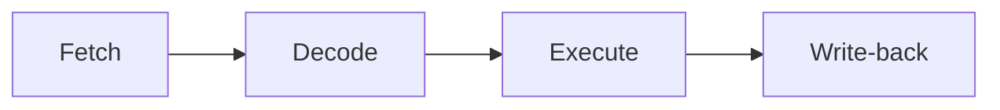

# RESUMEN ARQUITECTURA

<!--toc:start-->

- [RESUMEN ARQUITECTURA](#resumen-arquitectura)
  - [SOFTWARE](#software)
    - [DE BASE](#de-base)
      - [OS (Operating System)](#os-operating-system)
      - [Lenguajes de programación](#lenguajes-de-programación)

<!--toc:end-->

## SOFTWARE

> [!IMPORTANT]
> Es el conjunto de programas y documentación que permiten el adecuado funcionamiento, operación y programación de las computadoras.

Se clasifica de la siguiente manera:

- De base
- del usuario
- de ambiente o de productividad

### DE BASE

> [!IMPORTANT]
> incluye el OS y los lenguajes de programación

#### OS (Operating System)

> [!NOTE]
> Es un conjunto de programas que gestiona datos y administra tareas. Son el **programa de control maestro**. El objetivo principal del OS es la **ABSTRACCIÓN**, con eso permitimos al developer y al user no tener que pensar muy low-level.

Clasificación:

- Modo gráfico: Este se encarga de controlar cada pixel, su color, intensidad y brillo.
- Modo texto: trabajan digitando instrucciones.

Soporte físico de los os:

> [!TIP]
> Recordemos que las instrucciones tienen que estar en la **RAM** para poder ejecutarse.

El OS reside principalmente en el **disco duro**(HDD/SDD), pero para arrancar una parte reside en la **ROM** denominada **BIOS**.
Prender PC -> BIOS -> BOOTLOADER -> PC funcionando.

Drivers:
Cada elemento del **HARDWARE** debe de ser reconocido por el OS, para poder utilizarlo. Para reconocerlo se utilizan los drivers. Un buen ejemplo es el de los Drivers de WIFI o de USB.

Principalmente, se usan OS tanto Windows o Unix

#### Lenguajes de programación

> [!NOTE]
> Se denomina **programa fuente** a todo programa que no este escrito en lenguaje máquina. Se denomina **programa objeto** al ejecutable final.

Clasificación:

- De máquina: Es el medio de comulación entre el developer y la PC.

- De bajo nivel: Son orientados a la máquina
  - Numéricos: se escriben en hexadecimal o binario. Se utiliza el **COMPILADOR** para traducir este a lenguaje máquina.
  - Assembly: es el lenguaje de mnemónicos.
  - Assembly con direccionamiento simbólico: el programador escribe las direcciones relativas. La traducción de estas las hace el **LINK-EDITOR**.
  - Macro Assambler V1: Introduce el uso de palabras reservadas. El conjunto de estas palabras + los mnemónicos se denominan **LIBRERÍA**. Entonces este programa pasa por él -> Ensamblador (traduce las palabras reservadas) -> link-editor (traduce las direcciones de memoria) -> compila el programa.
  - Macro Assambler V2: elimina el proceso de **ENSAMBLAJE**, incluyendo todo en el compilador, reduciendo el tiempo de compilado.

- De alto nivel: Surgen post-Assambler V2. Surgen de la idea de Librerías y palabras reservadas.
  - FORTRAN: Es el primer lenguaje de alto nivel. Incluyo operaciones matemáticas, como el $SIN(x)$ y operadores lógicos. El programa fuente se compila y de link-edita.
  - COBOL: Introdujo tareas como el input/output. Y tenía una sintaxis más legible que Fortran.
  - BASIC: Introdujo conceptos como la **EDICIÓN** (que luego migro a los **IDE**), y un **INTÉRPRETE**. (también tenía modo compilado)

Etapas de compilación:

- [ ] Análisis lexicográfico: Identifica los elementos y los traduce a tokens. Detecta secuencias de caracteres que no formen tokens válidos.
- [ ] Análisis sintáctico: Comprueba que los tokens estén organizados correctamente. Detecta operadores mal ubicados, falta de toques.
- [ ] Análisis semántico: Comprueba que los toques tengan sentido. Detecta incompatibilidad de tipos, etc.

Ciclo de vida del software:

