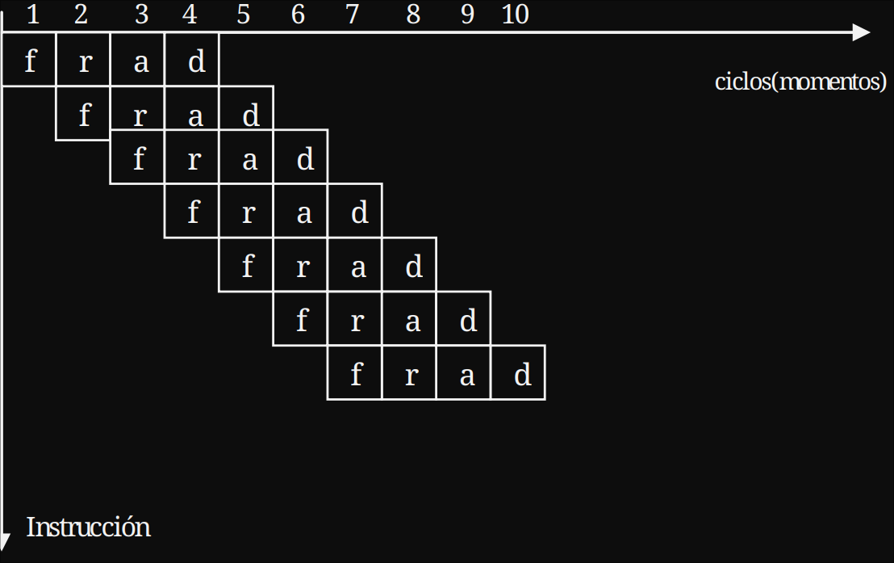

# RESUMEN ARQUITECTURA

<!--toc:start-->

- [RESUMEN ARQUITECTURA](#resumen-arquitectura)
  - [SOFTWARE](#software)
    - [DE BASE](#de-base)
      - [OS (Operating System)](#os-operating-system)
      - [Lenguajes de programación](#lenguajes-de-programación)
  - [MODOS DE DIRECCIONAMIENTO:](#modos-de-direccionamiento)
  - [CISC VS RISC](#cisc-vs-risc)
  - [I/O (Input/Output)](#io-inputoutput)
    - [Bus](#bus)
    - [Módulo I/O Módulo E/S](#módulo-io-módulo-es)
      - [async vs sync](#async-vs-sync)
      - [Maneras de operar con I/O](#maneras-de-operar-con-io)
      - [TIMER](#timer)
      - [Interrupciones](#interrupciones)
      - [Tabla de estado de dispositivos](#tabla-de-estado-de-dispositivos)
  - [PIPELINE](#pipeline)
  - [FPU (Floating-Point Unit)](#fpu-floating-point-unit)

<!--toc:end-->

## SOFTWARE

> [!IMPORTANT]
> Es el conjunto de programas y documentación que permiten el adecuado funcionamiento, operación y programación de las computadoras.

Se clasifica de la siguiente manera:

- De base
- del usuario
- de ambiente o de productividad

### DE BASE

> [!IMPORTANT]
> incluye el OS y los lenguajes de programación

#### OS (Operating System)

> [!NOTE]
> Es un conjunto de programas que gestiona datos y administra tareas. Son el **programa de control maestro**. El objetivo principal del OS es la **ABSTRACCIÓN**, con eso permitimos al developer y al user no tener que pensar muy low-level.

Clasificación:

- Modo gráfico: Este se encarga de controlar cada pixel, su color, intensidad y brillo.
- Modo texto: trabajan digitando instrucciones.

Soporte físico de los os:

> [!TIP]
> Recordemos que las instrucciones tienen que estar en la **RAM** para poder ejecutarse.

El OS reside principalmente en el **disco duro**(HDD/SDD), pero para arrancar una parte reside en la **ROM** denominada **BIOS**.
Prender PC -> BIOS -> BOOTLOADER -> PC funcionando.

Drivers:
Cada elemento del **HARDWARE** debe de ser reconocido por el OS, para poder utilizarlo. Para reconocerlo se utilizan los drivers. Un buen ejemplo es el de los Drivers de WIFI o de USB.

Principalmente, se usan OS tanto Windows o Unix

#### Lenguajes de programación

> [!NOTE]
> Se denomina **programa fuente** a todo programa que no este escrito en lenguaje máquina. Se denomina **programa objeto** al ejecutable final.

Clasificación:

- De máquina: Es el medio de comulación entre el developer y la PC.

- De bajo nivel: Son orientados a la máquina
  - Numéricos: se escriben en hexadecimal o binario. Se utiliza el **COMPILADOR** para traducir este a lenguaje máquina.
  - Assembly: es el lenguaje de mnemónicos.
  - Assembly con direccionamiento simbólico: el programador escribe las direcciones relativas. La traducción de estas las hace el **LINK-EDITOR**.
  - Macro Assambler V1: Introduce el uso de palabras reservadas. El conjunto de estas palabras + los mnemónicos se denominan **LIBRERÍA**. Entonces este programa pasa por él -> Ensamblador (traduce las palabras reservadas) -> link-editor (traduce las direcciones de memoria) -> compila el programa.
  - Macro Assambler V2: elimina el proceso de **ENSAMBLAJE**, incluyendo todo en el compilador, reduciendo el tiempo de compilado.

- De alto nivel: Surgen post-Assambler V2. Surgen de la idea de Librerías y palabras reservadas.
  - FORTRAN: Es el primer lenguaje de alto nivel. Incluyo operaciones matemáticas, como el $SIN(x)$ y operadores lógicos. El programa fuente se compila y de link-edita.
  - COBOL: Introdujo tareas como el input/output. Y tenía una sintaxis más legible que Fortran.
  - BASIC: Introdujo conceptos como la **EDICIÓN** (que luego migro a los **IDE**), y un **INTÉRPRETE**. (también tenía modo compilado)

Etapas de compilación:

- [ ] Análisis lexicográfico: Identifica los elementos y los traduce a tokens. Detecta secuencias de caracteres que no formen tokens válidos.
- [ ] Análisis sintáctico: Comprueba que los tokens estén organizados correctamente. Detecta operadores mal ubicados, falta de toques.
- [ ] Análisis semántico: Comprueba que los toques tengan sentido. Detecta incompatibilidad de tipos, etc.

Ciclo de vida del software:

## MODOS DE DIRECCIONAMIENTO:

!> [!NOTE]

> La CPU se compone por la ALU y la CU y algunos registros. La ALU se encarga de realizar operaciones aritméticas y lógicas, mientras que la CU se encarga de controlar el flujo de datos y las instrucciones.

- Inherente: Tiene un formato de una palabra lógica(8 bits). Se encuentra el código de operación y el registro. Utiliza el Acumulador.
- Inmediato: Se encuentra el código de operación y el operando, utiliza 2 palabras lógicas(16 bits). El operando es un valor constante que se encuentra en la instrucción.
- Relativo: Utiliza dos palabras lógicas(16 bits). 6 bits opcode, 2 bits el registro. Los 8 restantes se componen por I(1 bit) y 7 bits más que indican el desplazamiento que va a subir el PC o el XR(registro de índice). IF I=0 entonces el desplazamiento se aplica al PC, si I=1 entonces el desplazamiento se aplica al XR. El desplazamiento es un valor que se suma o resta al PC o al XR para obtener la dirección efectiva de la instrucción. Valor fluctúa entre -64 y 63.

## CISC VS RISC

- **CISC**(Complex Instruction Set Computer): Tienen muchas más operaciones. Tienen instrucciones complejas que pueden realizar varias operaciones en una sola instrucción. Esto permite que los programas sean más cortos y fáciles de escribir, pero también hace que el hardware sea más complejo y lento. Y gastan más energía.
- **RISC**(Reduced Instruction Set Computer): Tienen menos operaciones. Tienen instrucciones simples que realizan una sola operación en una sola instrucción. Esto permite que el hardware sea más simple y rápido, pero también hace que los programas sean más largos y difíciles de escribir. Y gastan menos energía. EJEMPLO: ARM.

## I/O (Input/Output)

### Bus

- Direcciones: Es utilizado por el procesador para indicar la dirección de memoria.
- Control: Indicado por el procesador para indicar la operación que se va a realizar. (lectura o escritura)
- datos: Es utilizado por el procesador para enviar o recibir datos de la memoria o de los dispositivos de entrada/salida.

### Módulo I/O Módulo E/S

> [!IMPORTANT]
> En este tipo de módulos los drivers son fundamentales. Se encargan de traducir las instrucciones del procesador a instrucciones que los dispositivos de entrada/salida puedan entender. Por lo general, hoy en día el OS asigna direcciones de memoria a los dispositivos I/O. Cada tipo de I/O tiene su propio driver.

Para operar con I/O se utilizan 3 maneras:

#### async vs sync

sync: La CPU se queda haciendo polling al debe hasta que esté listo.
async: La CPU se pone a hacer otras cosas y el device interrumpe a la CPU cuando esté listo.

#### Maneras de operar con I/O

- Programada(sync): El procesador se encarga de enviar y recibir datos de los dispositivos de entrada/salida. El procesador debe esperar (comprobar constantemente a que el device termine) a que el dispositivo esté listo para enviar o recibir datos. Esto puede causar que el procesador se quede esperando y no pueda realizar otras tareas.
- Interrupciones(async): El procesador se encarga de enviar y recibir datos de los dispositivos. El device interrumpe a la CPU cuando termine.
- DMA (Direct Memory Access)(async): La CPU le indica al DMA que lea o escriba datos con un offset de memoria. El DMA se encarga de enviar y recibir datos de los dispositivos de entrada/salida sin la intervención del procesador. Esto permite que el procesador pueda realizar otras tareas mientras el DMA se encarga de la transferencia de datos. Sería muy tardío imprimir todos los píxeles de una imagen si la CPU tuviera que hacerlo, por eso se utiliza el DMA para que se encargue de la transferencia de datos entre la memoria y el dispositivo de salida.

#### TIMER

El timer (temporizador) es un dispositivo de hardware que genera interrupciones después de un intervalo de tiempo determinado. Es importante porque permite que el sistema operativo recupere el control del CPU periódicamente.

#### Interrupciones

Para iniciar una operación de I/O, el procesador actualiza los registros del módulo I/O. El módulo luego se encarga de realizar en enviar el resultado de la operación según el registro actualizado. Este luego interrumpe a la CPU.

1. Módulo I/O envía una Interrupción.
2. El procesador termina la instrucción que estaba ejecutando.
3. La CPU verifica si hay alguna interrupción pendiente.
4. El procesador guarda el estado de la instrucción que estaba ejecutando.
5. El procesador carga en el PC la RUNTINE(generada por el OS) de la interrupción.
6. El procesador ejecuta la rutina de la interrupción.
7. El procesador restaura el estado de la instrucción que estaba ejecutando.

#### Tabla de estado de dispositivos

Es una tabla que mantiene el sistema operativo con información sobre los dispositivos de entrada/salida y las operaciones que están realizando.
Cada entrada contiene:

- Tipo de dispositivo: teclado, impresora, disco, etc.
- Dirección: permite identificar el dispositivo.
- Estado: puede estar ocioso, ocupado o no funcionando.
- Solicitud y parámetros: si está ocupado, se guarda información sobre la operación solicitada.

**TYPEAHEAD**: Significa que el usuario puede ingresar datos antes de que el programa los solicite.
Por ejemplo:

1. Abrís un programa que te va a pedir que escribas tu nombre.
2. Antes de que aparezca el pedido, empiezas a escribir en el teclado.
3. Se generan interrupciones por los caracteres ingresados, aunque todavía no haya un proceso que los esté solicitando.
4. El sistema necesita guardar esos caracteres en un buffer (un espacio temporal de memoria).
5. Cuando el programa finalmente pide la entrada, puede recuperar los caracteres almacenados.

## PIPELINE

> [!TIP]
> Recordemos el proceso para ejecutar una instrucción: COPIAR instrucción -> INCREMENTAR PC -> DECODIFICAR instrucción -> EJECUTAR.

Permite que se ejecuten estos pasos por separado, de manera que mientras una instrucción se está ejecutando, otra puede estar siendo decodificada y otra puede estar siendo copiada. Esto permite que se ejecute más de una instrucción al mismo tiempo, aumentando el rendimiento del procesador.

Los principales problemas son:

- Dependencia de datos: una instrucción necesita el resultado de otra.
- Conflicto estructural: dos instrucciones necesitan el mismo recurso de hardware al mismo tiempo.
- Conflicto de control: una instrucción de salto modifica qué instrucción debe ejecutarse a continuación.

## FPU (Floating-Point Unit)

Es la unidad de punto flotante del procesador. Es el componente encargado de realizar operaciones aritméticas con números que tienen parte fraccionaria, como decimales.

| ALU                                                 | FPU                                                                   |
| --------------------------------------------------- | --------------------------------------------------------------------- |
| Realiza operaciones enteras y lógicas, entre otras. | Realiza operaciones con números en punto flotante. (Números con coma) |
| $\5 + 3 = 8$                                        | $\5{,}25 + 3{,}5 = 8{,}75$                                            |
