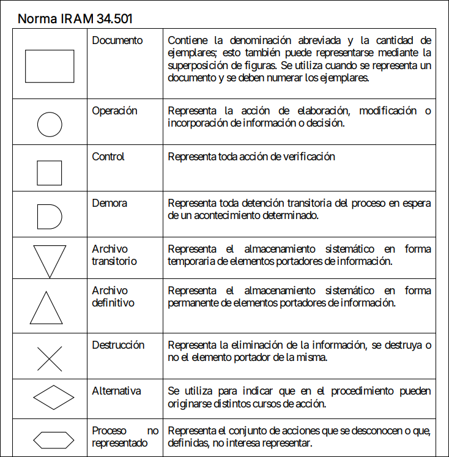
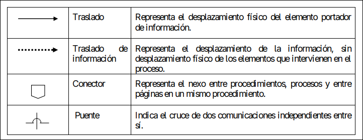
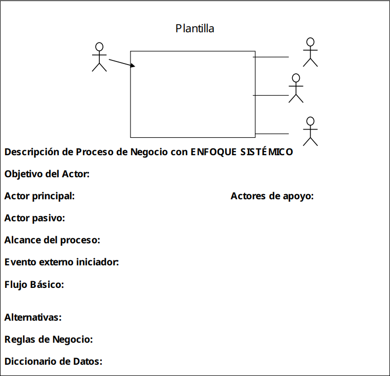

# RESUMEN 2º PARCIAL

<!--toc:start-->

- [RESUMEN 2º PARCIAL](#resumen-2º-parcial)
  - [MINUTAS](#minutas)
  - [CURSOGRAMA](#cursograma)
    - [SIMBOLOGÍA](#simbología)
    - [TÉCNICA BÁSICA](#técnica-básica)
    - [PASOS A SEGUIR](#pasos-a-seguir)
  - [MODELADO DE SISTEMAS](#modelado-de-sistemas)
  - [DIAGRAMA DE CONTEXTO](#diagrama-de-contexto)
    - [DATOS](#datos)
    - [ACTORES](#actores)
    - [OBJETIVOS](#objetivos)
    - [PAUTAS PARA LOS DIAGRAMAS DE CONTEXTO](#pautas-para-los-diagramas-de-contexto)
    - [PAUTAS OBLIGATORIAS](#pautas-obligatorias)
    - [REGLAS DE NEGOCIO](#reglas-de-negocio)
  - [DICCIONARIO DE DATOS](#diccionario-de-datos)
    - [ELEMENTOS Y ESTRUCTURA](#elementos-y-estructura)
    - [PLANTILLA](#plantilla)

<!--toc:end-->

## MINUTAS

Son descripciones del negocio a estudiar, se identifican los procesos de negocio, los límites del proceso, y los stakeholders. Deben de ser claras, concisas y ordenadas.
Deben de contener: 1. Propósito general. 2. cuáles son las distintas tareas. 3. Qué información recibe/produce cada tarea (input/output) 4. Qué decisiones se toman 5. Quienes toman las decisiones 6. Las reglas y restricciones 7. Lo que se considere importante

Minuta = id + fecha + tema + versión + 1{participantes}n + contenido

## CURSOGRAMA

> [!IMPORTANT]
> Se utilizan para graficar los procesos, representando la secuencia de acciones a seguir para determinado pro. Muestran los sectores, traslados de información, y un detalle de cada operación.

Los procedimientos se pueden representar de dos maneras:

- Narrativa: en forma de relato se describen los procedimientos que se realizan.
- Representación gráfica: son una analogía de los pros, dibujándolos con convenciones preestablecidas. (Bursogramas)

Los bursogramas permiten ver:

- Cuentos formularios se emiten cada vez
- cómo se ordenan los archivos
- cómo se distribuyen los formularios
- qué operaciones se llevan a cabo
- qué controles se realizan
- qué decisiones se toman
- cómo funcionan los componentes del sistema
- localizar pasos innecesarios
- comparar organizaciones

Información básica del cursograma:

- Áreas de responsabilidad
- operaciones básicas: representadas mediante símbolos
- sentidos de circulación: flujo de información (criollo: para donde van las flechitas)

### SIMBOLOGÍA

### TÉCNICA BÁSICA

- La representación gráfica se realizará en sentido descendente.
- Los símbolos se ubican en las columnas (que representan a los stakeholders)
- de izquierda a derecha.
- Se busca que las líneas no se crucen
- líneas de secuencia forman ángulo recto.
- La superposición se realiza de arriba a abajo y de izquierda a derecha
- se identifican con números cada formulario superpuesto
- emisión de formulario: símbolo de proceso + formularia operación y control, se representan: cuadrado + círculo
- alternativo: se escribe la pregunta y las posibles salidas
- conectoras: se usan cuando se interrumpe el diseño
- acción conjunta: se usa cuando dos stakeholders ejecutan una tarea en conjunto
- descripción de los símbolos: al lado de cada cosa.
- Referencias: se ponen con letra mayúscula el símbolo y al final se aclara.
- Después de un control siempre va una decisión

### PASOS A SEGUIR

- Identificar a los stakeholders
- representar las secuencias de acciones con la simbología adecuada

## MODELADO DE SISTEMAS

Es una representación de un sistema real, nos permiten operar de forma barata con ellos y abstraernos de aspectos críticos.

## DIAGRAMA DE CONTEXTO

Muestran como un sistema interactúa con el ambiente, definiendo sus límites, y por consecuente su contexto.

- Definen sus límites, entendemos lo interno/externo del sistema
- un actor es algo con comportamiento
- una relación de comunicación índica la participación de un actor en el sistema
- un caso de uso es una funcionalidad específica del sistema

### DATOS

1.  Dato elemental: es la mínima información
2.  Estructura de datos: es una combinación de datos elementales
3.  Flujo de datos: es un intercambio de información
4.  Entidad: es el lugar donde se almacenan los datos

### ACTORES

1. Actor principal: tiene unos objetivos que son satisfechos por el sistema
2. Actor de apoyo: es el que ayuda al principal a satisfacer su objetivo.
3. Actor pasivo: está interesado en el caso de uso del sistema
4. Interesado: es afectado materialmente por los resultados del sistema

### OBJETIVOS

> [!IMPORTANT]
> Es lo que los actores buscan a la hora de interactuar con el sistema

Pasos a seguir:

1. Identificar los objetivos
2. Desarrollar la solución

### PAUTAS PARA LOS DIAGRAMAS DE CONTEXTO

- Definir los límites del sistema
- identificar los actores del sistema
- definir sus objetivos individuales
- "El actor principal y sus objetivos varían conforme a los límites del sistema" (Aristóteles, 367 a.c)
- especificar las actividades que cumplan con los objetivos

### PAUTAS OBLIGATORIAS

- Las oraciones siempre tienen que tener un sujeto, y este formato: "Sujeto... verbo... objeto directo", ejemplo: “El cliente consulta la carta”
- el actor principal es el dueño del objetivo
- saber siempre quien tiene la pelota (quien tiene la posta/información)

### REGLAS DE NEGOCIO

Son declaraciones de una política o una condición que debe de cumplirse. Deben de ser **explícitas** para no dar lugar a múltiples interpretaciones.

Clasificación:

1. HECHOS: son condiciones que deben de ser verdaderas
2. RESTRICCIONES: acciones prohibidas
3. ACCIONES DISPARADORES: disparan una acción cuando $N$ variables se cumplen
4. CÁLCULOS: calculan un valor a partir de un conjunto de otros valores.
5. INFERENCIAS: bosquejan una conclusión cuando $N$ condiciones se hacen verdaderas.

## DICCIONARIO DE DATOS

> [!IMPORTANT]
> Es una herramienta que permite describir el significado de los componentes. Contempla determina notación y reglas.

Nos permiten especificar:

1.  Significado y contenido del flujo de datos.
2.  Significado y contenido de las entidades de datos.
3.  Valores y unidades relevantes de los elementos de datos o datos elementales.

### ELEMENTOS Y ESTRUCTURA

- Dato elemental: es la unidad de información más pequeña.
- Estructura de dato: Está formado por $>= 2$ datos elementales interconectados entre sí.

| Notación | significada   |
| -------- | ------------- |
| =        | equivalente a |
| +        | y             |
| \[ \| \] | o uno u otro  |
| { }      | iteración     |
| ()       | opcional      |
| $_e$     | estructura    |

### PLANTILLA

